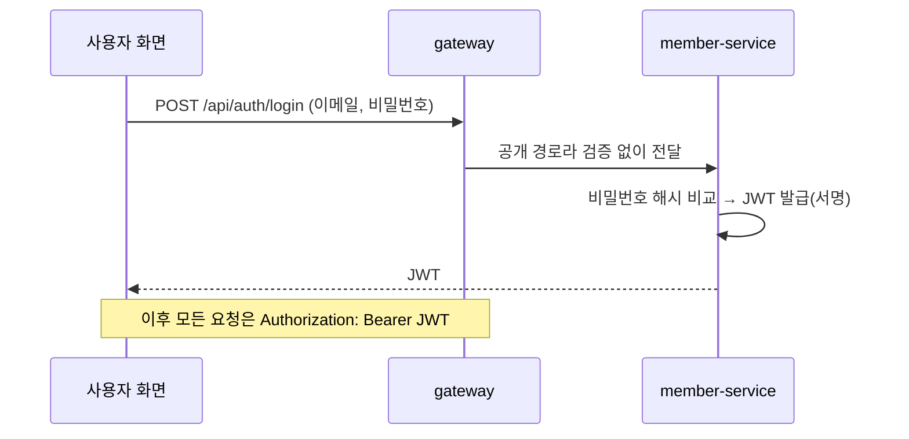

# member-service

> FreshLink의 **회원과 점포**를 다루는 서비스. 회원가입·로그인을 처리하고 로그인 토큰(JWT)을 발급하며, 고객이 점포를 검색할 수 있게 한다.

| 항목 | 내용 |
| --- | --- |
| 담당 | 김경우 |
| 관련 기능 ID | C-01 회원가입, C-02 로그인·로그아웃, U-01 점포 검색 |
| 기술 | Java 21, Spring Boot 3, Spring Data JPA, Spring Security, MySQL |
| 관측성 | Actuator·Micrometer → Prometheus (`/actuator/prometheus`, 관리 포트 8081) · Micrometer Tracing → Zipkin · JSON 로그(traceId 포함) → Alloy → Loki ([gitops/platform/observability](https://github.com/sesac-freshlink/gitops/tree/main/platform/observability)) |
| DB | RDS `freshlink-mysql`의 `member` 스키마 (DB 사용자 `member_app`) |
| 배포 | GitHub Actions → ECR `freshlink/member-service` → ArgoCD → EKS |

---

## 1. FreshLink는 무엇인가

편의점 점주와 고객이 **같은 재고 데이터**를 보는 서비스다. 고객이 결제하면 점주 화면의 재고가 정확하게 줄고, 유통기한이 지난 상품은 고객에게 팔리지 않는다. 전체 소개는 [Organization README](https://github.com/sesac-freshlink)를 참고한다.

## 2. 아키텍처에서의 위치



**토큰 발급은 이 서비스, 토큰 검증은 [gateway](https://github.com/sesac-freshlink/gateway)** 가 한다. 둘은 HS256 서명 키 하나를 공유한다(Kubernetes Secret).

## 3. API

| ID | 기능 | API | 완료 기준 |
| --- | --- | --- | --- |
| C-01 | 회원가입 | `POST /members` | 점주/고객 유형을 골라 가입된다. 이메일 중복 가입은 막힌다 |
| C-02 | 로그인 | `POST /auth/login` | JWT를 받고, 유형에 따라 점주·고객 화면으로 이동한다 |
| U-01 | 점포 검색 | `GET /stores?keyword=` | 점포명·주소 일부로 검색하면 목록이 나온다 |

API 문서는 Swagger(springdoc)로 자동 생성한다. 프론트는 이 문서를 보고 개발한다.

### JWT에 담는 정보

`userId`, `role`(OWNER/CUSTOMER), `storeId`(점주만), `exp`(1시간). 비밀번호 같은 민감 정보는 넣지 않는다. JWT 내용은 누구나 열어 볼 수 있고, 서명은 위조 방지만 해 준다.

## 4. 데이터 모델

| 표 | 주요 컬럼 |
| --- | --- |
| `member` | id, email, password(해시), name, role(OWNER/CUSTOMER) |
| `store` | id, store_code, name, address, owner_id |

다른 서비스의 표는 직접 조회하지 않는다. 필요하면 API로 받는다.

## 5. 폴더 구조

```
member-service/
├── src/main/java/com/freshlink/member/
│   ├── config/   # Security, Swagger 설정
│   ├── auth/     # 로그인, JWT 발급
│   ├── member/   # 회원가입, 회원 엔티티
│   └── store/    # 점포 엔티티, 점포 검색
├── src/main/resources/application.yml
└── src/test/java/com/freshlink/member/
```

## 6. 로컬에서 실행하기

> 아직 뼈대만 있는 상태다. 첫 작업으로 [Spring Initializr](https://start.spring.io)에서 Gradle·Java 21·Web·JPA·Security·MySQL Driver로 프로젝트를 만들고 이 구조에 맞춰 넣는다.

1. [local-dev](https://github.com/sesac-freshlink/local-dev) 레포에서 `docker compose up -d` (MySQL과 더미 데이터가 뜬다)
2. 이 레포에서

```bash
export DB_PASSWORD=<local-dev의 member_app 비밀번호>
export JWT_SECRET=local-dev-secret-at-least-32-bytes-long
./gradlew bootRun
```

3. `http://localhost:8081/swagger-ui.html`에서 API를 확인한다.

## 7. 브랜치와 기여

- `main`(배포) ← `dev`(통합, 기본 브랜치) ← `feat/<기능ID>-<설명>` (예: `feat/C-01-signup`)
- 커밋·PR 제목: `feat(C-01): 회원가입 API 추가`
- 승인 없이 담당자가 PR을 직접 합친다.

자세한 규칙은 [.github 레포](https://github.com/sesac-freshlink/.github)를 참고한다.
