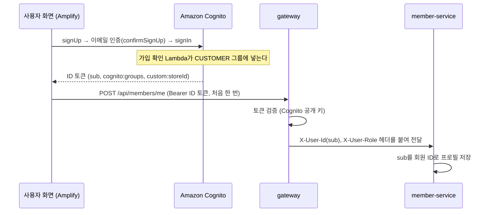

# member-service

> FreshLink의 **회원 프로필과 점포**를 다루는 서비스. 고객 프로필을 저장하고, 관리자가 점포와 점주 계정을 등록하며, 고객이 점포를 검색할 수 있게 한다. 가입·로그인·토큰 발급은 **Amazon Cognito**가 하므로 이 서비스는 비밀번호를 저장하지 않고 토큰을 다루지 않는다.

| 항목 | 내용 |
| --- | --- |
| 담당 | 김경우 |
| 관련 기능 ID | C-01 회원가입(프로필), C-02 로그인·로그아웃, U-01 점포 검색, A-01 점포·점주 등록, A-02 점포 목록·수정 |
| 기술 | Java 21, Spring Boot 4.0.x, Spring Data JPA, Flyway(테이블 마이그레이션), MySQL, AWS SDK v2 Cognito (AD-01 점주 계정: `ListUsers`·`AdminCreateUser`·`AdminSetUserPassword`·`AdminAddUserToGroup`·`AdminDeleteUser`, MB-02 구글 계정 확인: `ListUsers`) |
| 관측성 | Actuator·Micrometer → Prometheus (앱 포트의 `/actuator/prometheus`, 관리 포트를 따로 두지 않는다. 모든 서비스가 8080) · Micrometer Tracing → Zipkin · JSON 로그(traceId 포함) → Alloy → Loki ([gitops/platform/observability](https://github.com/sesac-freshlink/gitops/tree/main/platform/observability)) |
| DB | RDS `freshlink-mysql`의 `member` 스키마 (DB 사용자 `member_app`) |
| 배포 | GitHub Actions → ECR `freshlink/member-service` → ArgoCD → EKS |

---

## 1. FreshLink는 무엇인가

편의점 점주와 고객이 **같은 재고 데이터**를 보는 서비스다. 고객이 결제하면 점주 화면의 재고가 정확하게 줄고, 유통기한이 지난 상품은 고객에게 팔리지 않는다. 전체 소개는 [Organization README](https://github.com/sesac-freshlink)를 참고한다.

## 2. 아키텍처에서의 위치



**토큰 발급은 Amazon Cognito, 토큰 검증은 [gateway](https://github.com/sesac-freshlink/gateway)** 가 한다. 이 서비스는 gateway가 붙여 준 `X-User-Id`(= Cognito `sub`, UUID 문자열)만 믿고 쓴다.

> **변경 (2026-10-13):** 처음에는 이 서비스가 비밀번호 해시를 저장하고 HS256 JWT를 발급하기로 했으나, Amazon Cognito로 옮겼다. 로그인 API, 비밀번호 칸, JWT 발급 코드, 공유 서명 키가 모두 빠진다. AD-01 점주 초기 비밀번호만 요청으로 받아 Cognito에 넘기고 DB·로그에 남기지 않는다. 이유는 [infra/docs/기술스택과 선택이유.md](https://github.com/sesac-freshlink/infra/blob/main/docs/기술스택과%20선택이유.md) 3-7.

## 3. API

| ID | 기능 | API | 완료 기준 |
| --- | --- | --- | --- |
| C-01 (MB-01) | 닉네임 중복 확인 | `GET /members/nickname-availability?nickname=` (공개) | 앞뒤 공백 제거 + 영문 소문자로 비교한다. 형식(2~10자, 한글·영문·숫자)이 틀리면 400 |
| C-01 (MB-02) | 고객 프로필 등록 | `POST /members/me` (CUSTOMER) | 이름·닉네임·지역을 `sub` 기준으로 저장한다. 새로 저장 201, 같은 `sub`로 다시 부르면 기존 프로필 200, 대소문자만 다른 닉네임은 409 `NICKNAME_DUPLICATED`, 구글 로그인 계정인데 같은 이메일로 이미 이메일 가입한 계정이 있으면 409 `EMAIL_SIGNUP_EXISTS` |
| C-01 (MB-03) | 내 정보 조회 | `GET /members/me` (CUSTOMER·OWNER) | 고객은 이름·닉네임·지역, 점주는 이메일·점포(점포 ID·코드·이름)·지역. 프로필이 없으면 404 `MEMBER_PROFILE_NOT_FOUND` |
| C-02 | 로그인·로그아웃 | 없음 (프론트가 Cognito와 직접) | 이 서비스에는 로그인 API가 없다. 프론트가 Amplify `signIn`·`signOut`으로 처리한다 |
| A-01 (AD-01) | 점포·점주 등록 | `POST /admin/stores` (ADMIN) | 점포명·주소·시도·점주 이메일·초기 비밀번호로 등록하면 201, 점포는 `ACTIVE`, 점주는 OWNER 그룹·이메일 인증 완료·`custom:storeId`(= 점포 ID)·영구 비밀번호인 Cognito 계정. 점포명 중복(등록 중 포함) 409 `STORE_NAME_DUPLICATED`, Cognito에 같은 이메일(미인증 포함) 409 `OWNER_EMAIL_DUPLICATED`, 중간 실패 500 `STORE_REGISTRATION_FAILED`(이번 요청이 만든 계정·점포는 지운다) |
| A-02 (AD-02) | 관리자 점포 목록 | `GET /admin/stores?page=` (ADMIN) | 모든 상태 점포를 등록일 최신순으로 20개씩. 점주 이메일 포함(등록 중 점포는 `null`일 수 있다). 페이지 형식 `{content, page, size, totalElements, totalPages}` |
| A-02 (AD-03) | 관리자 점포 수정 | `PATCH /admin/stores/{storeId}` (ADMIN) | 보낸 필드(점포명·주소·시도)만 바꾼다. 바꿀 필드가 없으면 400, 없는 점포 404, 등록 중(`PENDING`) 409 `STORE_NOT_EDITABLE`, 다른 점포와 이름이 같으면 409 `STORE_NAME_DUPLICATED` |
| U-01 (ST-01) | 점포 검색 | `GET /stores?region=&keyword=` (공개) | `region`(없으면 `SEOUL`)의 `ACTIVE` 점포 중 점포명·주소 일부로 찾는다. 점포명순, 빈 검색어는 지역 전체, 결과가 없으면 빈 배열 |

- 구현된 것: ST-01 점포 검색, MB-01~03 회원 프로필, AD-01 점포·점주 등록, AD-02 점포 목록·AD-03 점포 수정(관리자). 오류 코드는 API 명세 5장 이름·문구와 같다(`MemberErrorCode`). `X-User-Role`은 그룹이 여럿이면 쉼표로 오므로 그중 하나만 맞으면 된다.
- ST-01: 응답은 `storeId`·`storeCode`·`name`·`address`·`region`(상태·점주 정보는 내리지 않는다). 검색어의 `%`·`_`는 글자 그대로 찾는다.

API 문서는 Swagger(springdoc)로 자동 생성한다. 프론트는 이 문서를 보고 개발한다.

### Cognito와 이어지는 부분

- 고객 계정: 화면이 gateway `/api/auth/*`(BFF)를 거쳐 Cognito에 가입한다. CUSTOMER 그룹은 가입 확인 Lambda 트리거가 넣는다(이메일 인증 확인 때만, 화면이 OWNER·ADMIN을 요청해도 CUSTOMER만). 이 서비스는 로그인 뒤 프로필(MB-02)만 저장한다.
- 구글 로그인 계정(2026-10-29): 같은 이메일로 이메일 가입과 구글 로그인을 하면 Cognito에는 사용자가 둘 생긴다. 한 사람이 계정 두 개를 갖지 않도록 MB-02에서 막는다. `ListUsers`로 `sub`의 사용자를 찾아 상태가 `EXTERNAL_PROVIDER`(구글)이면, 같은 이메일의 다른 사용자 중 `EXTERNAL_PROVIDER`가 아닌 계정이 있는지 본다. 있으면 409 `EMAIL_SIGNUP_EXISTS`이고 화면은 로그아웃한 뒤 이메일로 로그인하라고 안내한다. 이메일 가입 계정이나 User Pool ID가 없는 PC 실행은 그대로 통과한다(`domain/auth/CognitoSocialAccounts`).
- 점주 계정(AD-01): 관리자가 만든 계정은 가입 확인 Lambda를 거치지 않으므로 이 서비스가 만든다. 사용자 이름 = 이메일, `email_verified=true`, `custom:storeId` = 점포 ID(생성 때 같이 넣는다), 초대 메일 없음, 영구 비밀번호, OWNER 그룹. 중간에 실패하면 이번 요청이 만든 계정을 지운다. 점포 ID를 바꾸는 기능은 아직 없다(만들면 `AdminUpdateUserAttributes`를 쓴다).
- Cognito 관리자 권한은 IRSA Role로 이 User Pool에만 준다. `COGNITO_USER_POOL_ID`·`AWS_REGION`은 배포 설정(infra)이 넣는다.
- 더미 점주 3명은 시드 스크립트가 Cognito와 이 DB에 같이 넣는다 (E-12).

## 4. 데이터 모델

| 표 | 주요 컬럼 |
| --- | --- |
| `member` | id(PK, Cognito `sub`, `VARCHAR(36)`), role(CUSTOMER/OWNER), email(점주만), name·nickname·nickname_normalized(UNIQUE, 공백 제거 + 소문자)·region(고객만), created_at, updated_at. 비밀번호 칸은 없다 |
| `store` | id(PK, = Cognito `custom:storeId`), store_code(UNIQUE, `S`+id), name(UNIQUE), address, region, status(PENDING/ACTIVE/INACTIVE), owner_member_id(UNIQUE, = member.id, `PENDING`만 NULL), created_at, updated_at |

다른 서비스의 표는 직접 조회하지 않는다. 필요하면 API로 받는다.

시각 칼럼(`created_at`·`updated_at`)은 한국 시각 벽시계로 저장한다(`hibernate.timezone.default_storage: NORMALIZE` + `jdbc.time_zone: Asia/Seoul`, order-service와 같다). 응답은 `+09:00`이다.

## 5. 폴더 구조

```
member-service/
├── build.gradle                       # Boot 4.0.8, Web·JPA·Validation·Actuator·Flyway·MySQL·Testcontainers + common + AWS SDK Cognito·STS
├── src/main/java/com/freshlink/member/
│   ├── MemberServiceApplication.java
│   ├── common/                        # 도메인과 상관없는 공통 코드
│   │   ├── config/   # JPA Auditing, Swagger, Cognito 클라이언트(CognitoConfig: COGNITO_USER_POOL_ID, AWS_REGION)
│   │   ├── error/    # MemberErrorCode(enum), GlobalExceptionHandler
│   │   └── web/      # gateway가 넘기는 헤더 이름과 역할 확인(AuthHeaders)
│   └── domain/                        # 도메인별 엔티티·서비스·API
│       ├── admin/    # 관리자 점포 등록·목록·수정 (AdminStoreController, StoreRegistrationService, AdminStoreService)
│       ├── auth/     # 점주 Cognito 계정 (OwnerAccounts, CognitoOwnerAccounts: 계정 확인·생성·삭제)
│       ├── member/   # 회원 엔티티, 닉네임 확인·프로필 등록·내 정보 (MemberController·MemberService)
│       └── store/    # 점포 엔티티(Store·Region·StoreStatus), 점포 검색(StoreController·StoreService)
├── src/main/resources/
│   ├── application.yml                # 공통. 값은 환경 변수
│   ├── application-dev.yml            # 로그 레벨만 다름
│   ├── application-prod.yml
│   └── db/migration/                  # Flyway SQL. V1__init.sql 부터
└── src/test/java/com/freshlink/member/
    ├── common/error/GlobalExceptionHandlerTest.java   # 오류 응답 모양 (DB 없이)
    ├── domain/admin/                                   # 관리자 점포 등록(Cognito 목)·목록·수정 (Testcontainers MySQL)
    ├── domain/auth/CognitoOwnerAccountsTest.java      # Cognito 요청 모양 (SDK 클라이언트 목)
    ├── domain/member/MemberProfileIntegrationTest.java # 닉네임·프로필·내 정보 (Testcontainers MySQL)
    └── domain/store/StoreSearchIntegrationTest.java   # 점포 검색 (Testcontainers MySQL)
```

## 5-1. 오류 처리

규칙은 .github 레포 `docs/백엔드-공통-규칙.md` 6장. 응답 모양은 common 라이브러리, 오류 목록과 핸들러는 이 레포에 있다.

| 할 일 | 방법 |
| --- | --- |
| 업무 오류 던지기 | `throw new BusinessException(MemberErrorCode.MEMBER_PROFILE_NOT_FOUND);` 한 줄 |
| 오류 코드 추가 | `common/error/MemberErrorCode`에 `XXX(404, "메시지")` 한 줄. 핸들러는 안 건드린다 |
| 응답 모양 | 항상 `{"code": "MEMBER_PROFILE_NOT_FOUND", "message": "회원 정보가 없습니다", "traceId": "4bf92f3577b34da6"}`. `@Valid` 실패는 400 `VALIDATION_ERROR`(message에 필드별 사유), 없는 경로는 404 `NOT_FOUND`, 그 밖은 500 `INTERNAL_ERROR`(원인은 로그에만) |

## 6. dev 환경에서 실행하기

> **DB 없이 IntelliJ에서 띄우기:** Docker Desktop을 켜고 `src/test/java/com/freshlink/member/TestMemberServiceApplication`을 Run 한다. DB를 따로 띄우지 않아도 MySQL 8.4 이미지를 받아 컨테이너로 띄우고 자동으로 붙는다 (Testcontainers 라이브러리 기능). main 소스 변경사항이 그대로 반영된다. RDS가 준비되면 아래처럼 `DB_URL` 환경 변수만 주고 `MemberServiceApplication`으로 실행한다.

개발할 때도 AWS dev 환경의 RDS·SQS·Cognito를 그대로 쓴다. AWS 로그인, DB 포트 포워딩(SSM), 개인 큐 설정은 [개발 환경 접속 가이드](https://github.com/sesac-freshlink/.github/blob/main/docs/개발환경-접속.md)를 따른다.

```bash
export SPRING_PROFILES_ACTIVE=dev
export DB_URL=jdbc:mysql://127.0.0.1:3306/member      # SSM 포트 포워딩으로 연결한 dev RDS
export DB_PASSWORD=<dev Secrets Manager의 member_app 비밀번호>
export COGNITO_USER_POOL_ID=<dev UserPoolId>          # AD-01 점주 계정 생성에만 쓴다
export AWS_REGION=ap-northeast-2                      # 없으면 ap-northeast-2
./gradlew bootRun
```

gateway 없이 직접 부를 때는 `X-User-Id`, `X-User-Role` 헤더를 손으로 붙인다. API는 실행한 서비스의 `/swagger-ui.html`에서 확인한다.

## 7. 브랜치와 기여

- `main`(배포) ← `dev`(통합, 기본 브랜치) ← `feat/<기능ID>-<설명>` (예: `feat/C-01-signup`)
- 커밋·PR 제목: `feat(C-01): 회원가입 API 추가`
- PR·승인은 필수가 아니다. 담당자가 `dev`·`main`에 직접 push해도 된다.

자세한 규칙은 [.github 레포](https://github.com/sesac-freshlink/.github)를 참고한다.
