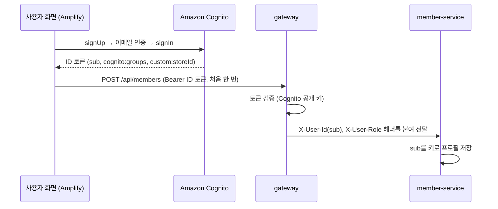

# member-service

> FreshLink의 **회원 프로필과 점포**를 다루는 서비스. 회원 프로필을 저장하고 점주를 점포에 연결하며, 고객이 점포를 검색할 수 있게 한다. 가입·로그인·토큰 발급은 **Amazon Cognito**가 하므로 이 서비스는 비밀번호와 토큰을 다루지 않는다.

| 항목 | 내용 |
| --- | --- |
| 담당 | 김경우 |
| 관련 기능 ID | C-01 회원가입, C-02 로그인·로그아웃, U-01 점포 검색 |
| 기술 | Java 21, Spring Boot 4.0.x, Spring Data JPA, MySQL, AWS SDK v2 (Cognito `AdminUpdateUserAttributes`) |
| 관측성 | Actuator·Micrometer → Prometheus (앱 포트의 `/actuator/prometheus`, 관리 포트를 따로 두지 않는다. 모든 서비스가 8080) · Micrometer Tracing → Zipkin · JSON 로그(traceId 포함) → Alloy → Loki ([gitops/platform/observability](https://github.com/sesac-freshlink/gitops/tree/main/platform/observability)) |
| DB | RDS `freshlink-mysql`의 `member` 스키마 (DB 사용자 `member_app`) |
| 배포 | GitHub Actions → ECR `freshlink/member-service` → ArgoCD → EKS |

---

## 1. FreshLink는 무엇인가

편의점 점주와 고객이 **같은 재고 데이터**를 보는 서비스다. 고객이 결제하면 점주 화면의 재고가 정확하게 줄고, 유통기한이 지난 상품은 고객에게 팔리지 않는다. 전체 소개는 [Organization README](https://github.com/sesac-freshlink)를 참고한다.

## 2. 아키텍처에서의 위치



**토큰 발급은 Amazon Cognito, 토큰 검증은 [gateway](https://github.com/sesac-freshlink/gateway)** 가 한다. 이 서비스는 gateway가 붙여 준 `X-User-Id`(= Cognito `sub`, UUID 문자열)만 믿고 쓴다.

> **변경 (2026-10-13):** 처음에는 이 서비스가 비밀번호 해시를 저장하고 HS256 JWT를 발급하기로 했으나, Amazon Cognito로 옮겼다. 로그인 API, 비밀번호 칸, JWT 발급 코드, 공유 서명 키가 모두 빠진다. 이유는 [infra/docs/기술스택과 선택이유.md](https://github.com/sesac-freshlink/infra/blob/main/docs/기술스택과%20선택이유.md) 3-7.

## 3. API

| ID | 기능 | API | 완료 기준 |
| --- | --- | --- | --- |
| C-01 | 회원가입 (프로필 등록) | `POST /members` (토큰 필요) | Cognito 가입·이메일 인증을 마친 사용자가 처음 로그인하면 프로필(이름, 유형)이 `sub` 기준으로 저장된다. 같은 `sub`로 두 번 부르면 기존 프로필을 돌려준다 |
| C-02 | 로그인·로그아웃 | 없음 (프론트가 Cognito와 직접) | 이 서비스에는 로그인 API가 없다. 프론트가 Amplify `signIn`·`signOut`으로 처리한다 |
| U-01 | 점포 검색 | `GET /stores?keyword=` | 점포명·주소 일부로 검색하면 목록이 나온다 |

API 문서는 Swagger(springdoc)로 자동 생성한다. 프론트는 이 문서를 보고 개발한다.

### Cognito와 이어지는 부분

- 점주를 점포에 연결할 때 Cognito `AdminUpdateUserAttributes`로 `custom:storeId`를 넣는다. 다음에 받는 ID 토큰부터 `custom:storeId`가 들어간다(화면은 토큰을 강제로 새로 받는다). 권한은 IRSA Role로 이 User Pool에만 준다.
- 그룹(OWNER/CUSTOMER) 배정은 가입 확인 Lambda 트리거가 화면이 넘긴 `clientMetadata.role`을 보고 하므로 이 서비스가 하지 않는다.
- 더미 점주 3명은 시드 스크립트가 Cognito와 이 DB에 같이 넣는다 (E-12).

## 4. 데이터 모델

| 표 | 주요 컬럼 |
| --- | --- |
| `member` | sub(PK, Cognito 사용자 ID, `VARCHAR(36)`), email, name, role(OWNER/CUSTOMER), created_at. 비밀번호 칸은 없다 |
| `store` | id, store_code, name, address, owner_id(= member.sub) |

다른 서비스의 표는 직접 조회하지 않는다. 필요하면 API로 받는다.

## 5. 폴더 구조

```
member-service/
├── src/main/java/com/freshlink/member/
│   ├── config/   # Swagger, Cognito 클라이언트 설정
│   ├── member/   # 프로필 등록, 회원 엔티티
│   └── store/    # 점포 엔티티, 점포 검색
├── src/main/resources/application.yml
└── src/test/java/com/freshlink/member/
```

## 6. dev 환경에서 실행하기

> 아직 뼈대만 있는 상태다. 첫 작업으로 [Spring Initializr](https://start.spring.io)에서 Gradle·Java 21·Web·JPA·MySQL Driver로 프로젝트를 만들고 이 구조에 맞춰 넣는다.

개발할 때도 AWS dev 환경의 RDS·SQS·Cognito를 그대로 쓴다. AWS 로그인, DB 포트 포워딩(SSM), 개인 큐 설정은 [개발 환경 접속 가이드](https://github.com/sesac-freshlink/.github/blob/main/docs/개발환경-접속.md)를 따른다.

```bash
export SPRING_PROFILES_ACTIVE=dev
export DB_URL=jdbc:mysql://127.0.0.1:3306/member      # SSM 포트 포워딩으로 연결한 dev RDS
export DB_PASSWORD=<dev Secrets Manager의 member_app 비밀번호>
export COGNITO_USER_POOL_ID=<dev UserPoolId>          # 점주 storeId 연결에만 쓴다
./gradlew bootRun
```

gateway 없이 직접 부를 때는 `X-User-Id`, `X-User-Role` 헤더를 손으로 붙인다. API는 실행한 서비스의 `/swagger-ui.html`에서 확인한다.

## 7. 브랜치와 기여

- `main`(배포) ← `dev`(통합, 기본 브랜치) ← `feat/<기능ID>-<설명>` (예: `feat/C-01-signup`)
- 커밋·PR 제목: `feat(C-01): 회원가입 API 추가`
- PR·승인은 필수가 아니다. 담당자가 `dev`·`main`에 직접 push해도 된다.

자세한 규칙은 [.github 레포](https://github.com/sesac-freshlink/.github)를 참고한다.
